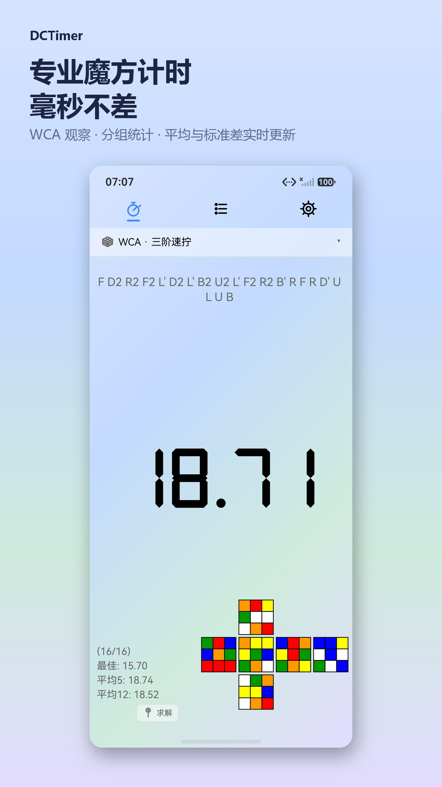
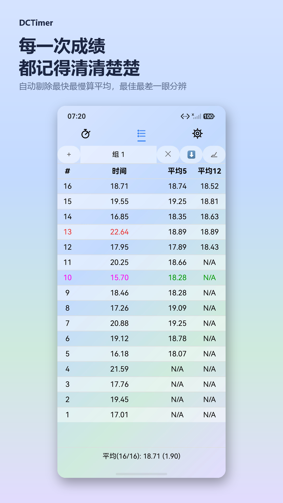
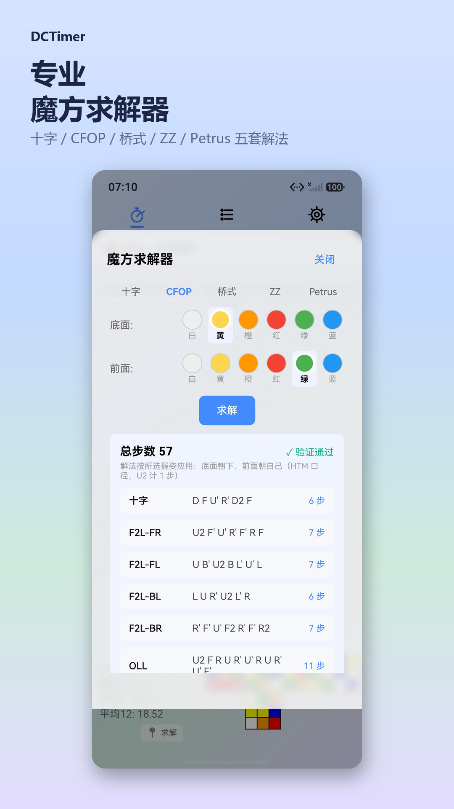
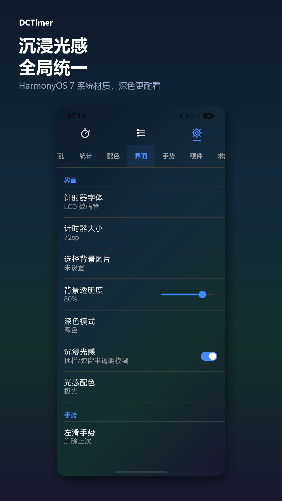

# DCTimer · HarmonyOS

> 魔方计时与训练工具的鸿蒙原生版 —— 界面重绘、逻辑移植自 [DCTimer](https://github.com/MeigenChou/DCTimer-Android) 与 [csTimer](https://github.com/cs0x7f/cstimer)，用 ArkTS / ArkUI 声明式开发。

<p align="center">
  
  
  
  
</p>

## 功能

**计时** · 触屏启停、WCA 15 秒观察倒计时、启动延时、1~3 段分段计时、厘秒 / 毫秒双精度。

**打乱** · 141 种打乱类型、22 个分类，覆盖全部 WCA 项目；含 F2L / OLL / PLL / ZBLL / CLL / CMLL+LSE 等专项子集；打乱状态图实时渲染。

**成绩** · 自动统计最佳 / 最差 / 平均 / 标准差；两组可独立配置的滚动平均（3/5/12/50/100，ao 与 mo 可切，自动剔除最快最慢）；趋势折线图；CSV 导出；多分组管理。

**求解器** · 三阶五套解法（十字 / CFOP / 桥式 / ZZ / Petrus），二阶（面法 / 一层法）、金字塔、Square-1 亦有解；重表建在 taskpool 里，不卡主线程。

**界面** · 沉浸光感（HarmonyOS 7 系统材质）、三套内置渐变、浅色 / 深色 / 跟随系统三态主题、自定义背景图（含裁剪）。

## 宣传片

40 秒产品演示片，无旁白无字幕 —— 一次完整计时串起打乱、停表、成绩、趋势与 CFOP 求解。

- [1440p 主交付](docs/promo/film/DCTimer-宣传片-1440p.mp4)（2560×1440 · 13.8 Mbps · 67 MB）
- [1080p 分享版](docs/promo/film/DCTimer-宣传片-1080p-分享版.mp4)（1920×1080 · 8.0 Mbps · 39 MB）

制作方式与分镜见 [docs/promo/film](docs/promo/film/)。

## 截图

| 手机（1080×1920） | 平板（1920×1280） |
|---|---|
| [docs/store_shots](docs/store_shots/) | [docs/store_shots_tablet](docs/store_shots_tablet/) |

## 环境要求

| 项 | 版本 |
|---|---|
| DevEco Studio | 6.1.1 及以上 |
| HarmonyOS SDK | API 24（targetSdkVersion `6.1.1(24)`） |
| 最低兼容 | API 12（compatibleSdkVersion `5.0.0(12)`） |
| 运行时依赖 | 无（只用官方 kit） |

> `compatibleSdkVersion` 刻意下调到 12 以覆盖更多设备。如果你的改动依赖 API 24+ 的新能力，请自行评估，**不要为了省事直接把 minAPI 提到 24**。

## 构建

```powershell
# 1. 用 DevEco Studio 打开本目录，等待同步完成
# 2. 配置签名（见下）
# 3. 命令行构建
$env:NODE_HOME = '<DevEco>/tools/node'
$env:DEVECO_SDK_HOME = '<DevEco>/sdk'
$env:JAVA_HOME = '<DevEco>/jbr'

# HAP（module 模式）
& '<DevEco>/tools/hvigor/bin/hvigorw.bat' --mode module `
    -p product=default -p module=entry -p buildMode=release assembleHap --no-daemon

# .app（project 模式，上架用）
& '<DevEco>/tools/hvigor/bin/hvigorw.bat' --mode project `
    -p product=default -p buildMode=release assembleApp --no-daemon
```

> **注意**：`assembleApp` 只能用 `--mode project` 且不传 `-p module=entry`，否则报 `00306054 Task ['assembleApp'] was not found`。
>
> hvigor 的退出码经常是 1 —— 那是 deprecated 警告走了 stderr。**判断成功看日志里的 `BUILD SUCCESSFUL` 和产物时间戳**，别只看 `$LASTEXITCODE`。

### 签名

仓库里 `build-profile.json5` 的 `signingConfigs` 是空数组，需要你自己配置：

1. DevEco Studio → File → Project Structure → Signing Configs → 勾选 Automatically generate signature（本地调试够用）
2. 正式发布则使用 AGC 申请的材料（`.p12` / `.p7b` / `.cer`）

**切勿把真实的 `storePassword` / `keyPassword` 提交进仓库。**

## 目录结构

```
entry/src/main/ets/
├── pages/Index.ets        主页面（约 3800 行，全部 UI 在此）
├── view/                  可复用视图组件
│   ├── MethodSolverView   求解器页签容器
│   ├── AltSolverView      非三阶求解 UI
│   ├── CrossSolverView    十字求解
│   ├── StatsChartView     趋势折线图（Canvas）
│   └── ColorSchemeEditor  配色编辑
├── solver/                求解引擎（约 9700 行）
│   ├── SolverCore.ets     核心搜索 + 剪枝表
│   ├── CfopSolve.ets      CFOP 完整解法
│   ├── RouxSolve.ets      桥式解法
│   ├── AltSolverRunner    非三阶离线程入口
│   └── ...
├── cs/                    打乱算法（min2phase / sq12phase / threephase）
├── scrambler/             打乱分发与状态生成
├── model/                 数据模型与全局配置
├── database/              RDB 封装
└── util/                  统计、导出、主题、BLE 等工具
```

## 开发提示

**ArkTS 是 TS 的严格子集**，这几条踩过很多次：

- 禁用 `any` / `unknown`
- 对象字面量不能当类型用，必须定义 `interface`
- 组件成员命名避开 `scale` / `width` / `height` 等基类属性
- 给官方 Options 传字面量时**禁止加 `as` 断言** —— 会掩盖必填参数缺失，运行时静默失效

**沉浸光感的两个硬约束**（实测得出）：

- `.systemMaterial()` 与 `.backgroundColor()` **互斥**，同一属性链上只要出现 `backgroundColor`（哪怕是 `Color.Transparent` 或 `undefined`），材质就被完全盖掉
- `BlurStyle.COMPONENT_*` 自带浅色材质，深色模式下会把面板渲染成浅灰，不跟主题走 —— 想跟随主题请用 `backdropBlur()` + 自己设 `backgroundColor`

**UI 层的高度陷阱**：子容器写 `.height('100%')` 会按父容器**总高度**计算，吃掉父级的 `padding`。要让安全区 padding 生效，用 `.layoutWeight(1)`。

## 隐私

不联网、不上传任何数据。成绩、设置、背景图全部存在本地（RDB + Preferences）。详见 [docs/privacy_policy.md](docs/privacy_policy.md)。

## 二次开发参考

移植自以下项目，感谢原作者：

- [DCTimer-Android](https://github.com/MeigenChou/DCTimer-Android) — MeigenChou
- [DCTimer-iOS](https://github.com/MeigenChou/DCTimer-iOS) — MeigenChou
- [csTimer](https://github.com/cs0x7f/cstimer) — cs0x7f

## License

[GPL-3.0](LICENSE)
